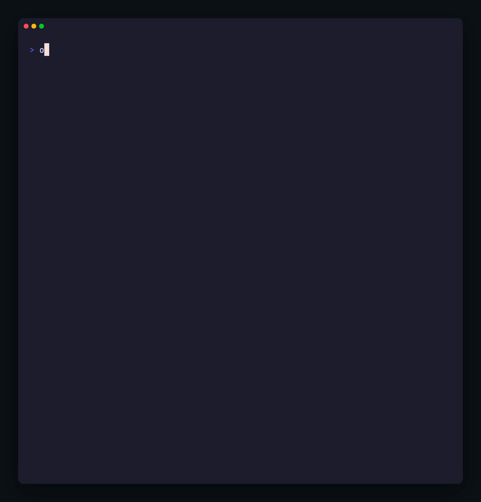

<div align="center">

<picture>
  <source media="(prefers-color-scheme: dark)" srcset="assets/logo-dark.svg">
  
</picture>

<h1>clap-couture</h1>

<p>
  <strong>Haute couture for your command line.</strong><br>
  Categorized <code>--help</code>, interactive prompts, and markdown for your
  <a href="https://docs.rs/clap"><code>clap</code></a> CLI, with only a few
  derive attributes.
</p>

<p>
  <a href="https://crates.io/crates/clap-couture"></a>
  <a href="https://docs.rs/clap-couture"></a>
  <a href="https://github.com/markovejnovic/clap-couture/actions/workflows/ci.yml"></a>
  <a href="#getting-started"></a>
  <a href="https://crates.io/crates/clap"></a>
  <a href="LICENSE"></a>
</p>

</div>

<div align="center">
<picture>
  <source media="(prefers-color-scheme: light)" srcset="assets/99-full-example-light.gif">
  
</picture>
</div>

With `clap-couture`, you can:

- Organize your subcommands in **categories**.
- Ask for **interactive input** when the user doesn't pass required CLI flags.
  - The user can pass `--flag -` to read interactively (or from stdin).
  - You can ask for input on `$EDITOR`.
- Decorate your CLI help with markdown.

# Getting Started

Install it:

```bash
cargo add clap-couture
```

Import `clap_couture`, add the `Couture` derive, and swap out `parse` for `couture_parse`.


```diff
 use clap::Parser;
+use clap_couture::{Couture, CoutureParser as _};
+
-#[derive(Parser)]
+#[derive(Parser, Couture)]
 struct Cli { /* ... */ }

-let cli = Cli::parse();
+let cli = Cli::couture_parse();
```

## Tour

The aim of `clap-couture` is to help you make your CLI as friendly as humanly possible.

### Categories

`clap` lists every subcommand under one `Commands:` heading. That's fine with
five commands, and a wall of text with thirty. Couture lets you group them:

```rust
#[derive(Subcommand, Couture)]
#[couture(categories = {
    "deploy" = {},
    "account" = {
        title = "Account & sync:",
        description = "Who you are, on every machine"
    },
})]
enum Cmd {
    #[couture(category = "deploy")]  Deploy,
    #[couture(category = "account")] Login,
    Logs, // uncategorized lists at the top, without a category
    #[couture(category = "deploy")]  Rollback,
    Search,
    #[couture(category = "deploy")]  Secrets,
    Status,
    #[couture(category = "account")] Sync,
}
```

## Prompts

Clap isn't really interactive. clap-couture fills that gap--mark an arg with
`#[couture(prompt)]`, and when the user leaves it out, couture asks for it.

```rust
#[derive(Parser, Couture)]
struct Cli {
    /// Application name.
    #[arg(long)]
    #[couture(prompt)] // asks the user if they don't pass --app
    app: String,

    #[arg(long)]
    // you can tweak the prompt!
    #[couture(prompt = "Tail the logs afterwards?")]
    follow: bool,

    #[arg(long, value_enum)]
    // multi-choice questions!
    #[couture(prompt = "Which region?")]
    region: Region,

    // we'll pre-fill the default value from clap in the input form!
    #[arg(long, default_value_t = 2)]
    #[couture(prompt = "How many replicas?")]
    replicas: u16,

    // secret support is built-in too and it uses secrecy.
    #[arg(long)]
    #[couture(secret)]
    password: SecretString,

    // the user can pass --user - and couture will ask them for the username
    // (or read from stdin if there's no terminal)
    #[arg(long)]
    #[couture(stdin)]
    username: String,

    // passing --flair-type - asks the user interactively (but this one doesn't
    // fall back to the pipe).
    #[arg(long)]
    #[couture(dash)]
    flair_type: String,
}
```

The prompt fits the field's type:

| Field                          | Prompt                                   |
|--------------------------------|------------------------------------------|
| `bool`                         | yes/no                                   |
| a `ValueEnum`                  | picker                                   |
| `Vec` of a `ValueEnum`         | multi-picker                             |
| `Vec<T>`                       | one value at a time                      |
| `Option<T>`                    | skippable                                |
| `SecretString`, with `secret`  | masked, like `sudo`                      |
| any one value, with `editor`   | your `$EDITOR`, like `git commit`        |

There are three backends, controlled through feature flags:
`interactive-cliclack` (default), `interactive-inquire` and
`interactive-dialoguer`, using those libraries.

## Markdown

With the `markdown` feature (or `full`), doc comments and category descriptions
are CommonMark, rendered in the terminal. That gives `*`, `_` and `<...>` their
markdown meaning, so plain help text keeps them only without it. Turn it on
with `cargo add clap-couture --features markdown`:

```rust
enum Cmd {
    /// Ship the **current** project.
    Deploy,
    /// Sign in to *your* account.
    Login,
}
```

# Learn more

- [The docs](https://docs.rs/clap-couture) go into a lot more detail!
- [The examples](crates/clap-couture/examples), each runnable with
  `cargo run -p clap-couture --features full --example <name>`.

# AI Disclosure

I used Claude pretty aggressively for this project. If you're not comfortable
with that, this may not be the project for you. All interfaces are
hand-designed, all public docs are hand-written, but the implementation is not
hand-written. It is all reviewed, of course.

# Donationware

**`clap-couture` is donationware.** That means that if you like `clap-couture`,
if you like my work and if you want to support `clap-couture` or me, you
*should* donate. Here are some institutions you can consider:

- 🌍 [United World College](https://uwc.org/support-us/) transformed my life by
  taking me from a small town and opening my eyes to different cultures,
  worldly perspectives and helping me be financially secure. **Help provide
  kids the same opportunity.** My cohort are all amazing people who are all
  transforming the world.
- 🇮🇷 [Children of Persia](https://www.childrenofpersia.org/) is a fund which
  provides sustainable healthcare and education support to children in Iran.
  With the ongoing war, **children need our support more than ever**. **Help
  kids in Iran have a better chance at life.** (_Note this is one of the few
  charities which directly supports Iran and that US donors can donate to._)
- 🇵🇸 [Palestine Children's Relief Fund](https://www.pcrf.net/) provides medical
  care to injured and ill children who need access to medical care. **Help kids
  survive adversity.**
- 🇺🇳 [UNICEF Early Childhood Development
  Kit](https://www.unicef.org/supply/early-childhood-development-ecd-kit)
  provides toys across the world to reduce the severity of developmental issues
  to kids caught in conflicts. **Help toddlers and very young children
  develop.**
- 🇺🇸 [Donors Choose](https://www.donorschoose.org/) is [empirically
  proven](https://news.umich.edu/even-small-crowdsourced-projects-from-teachers-make-a-difference-for-students/)
  to improve kids scores in US schools by about 1%. **If you care about
  supporting kids in the US, this is the one.**
- 🇨🇳 [Standford REAP](https://sccei.fsi.stanford.edu/reap) aims to make an
  educational improvement in rural China. [Roughly 85% of toddlers growing up
in rural China experience development
delay](https://www.sciencedirect.com/science/article/pii/S014759671930023X?via%3Dihub).
  During my high-school, I have met with some of the wonderful, bright and
  curious kids in rural schools from Hubei. **Help rural Chinese kids avoid
  developmental delays and improve education** For any Chinese natives, please
  reach out to me if you know of a better charity that suits China's needs
  better.

# License

[MIT](LICENSE)
