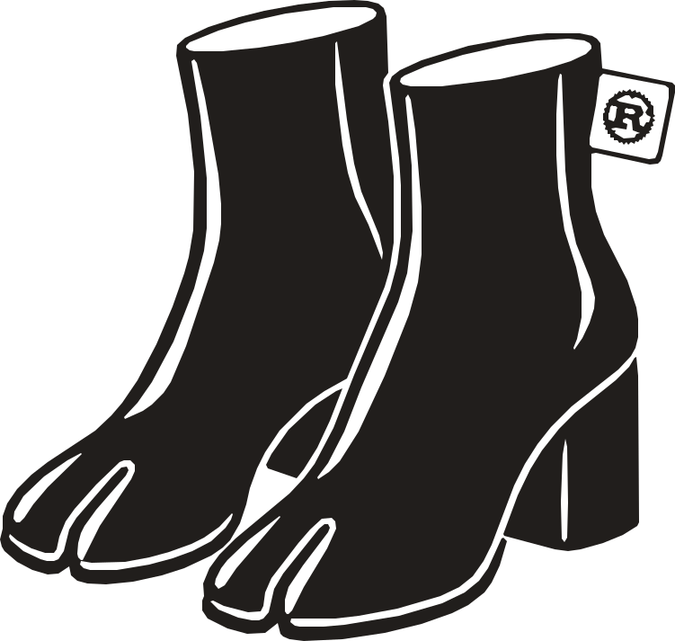
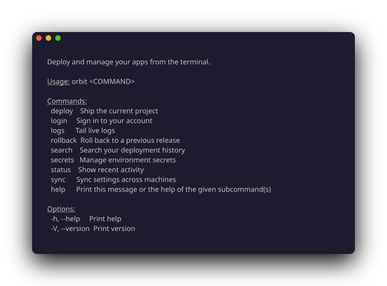
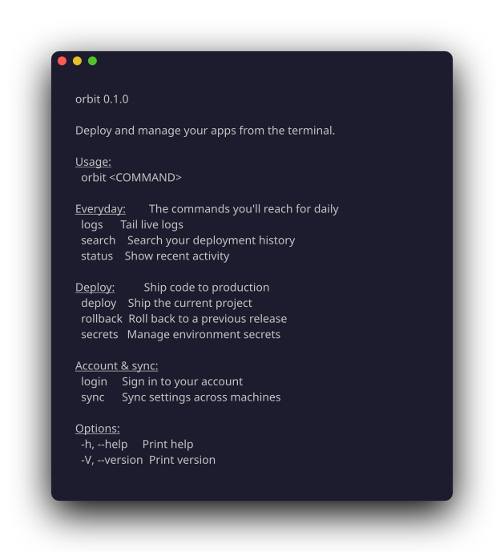
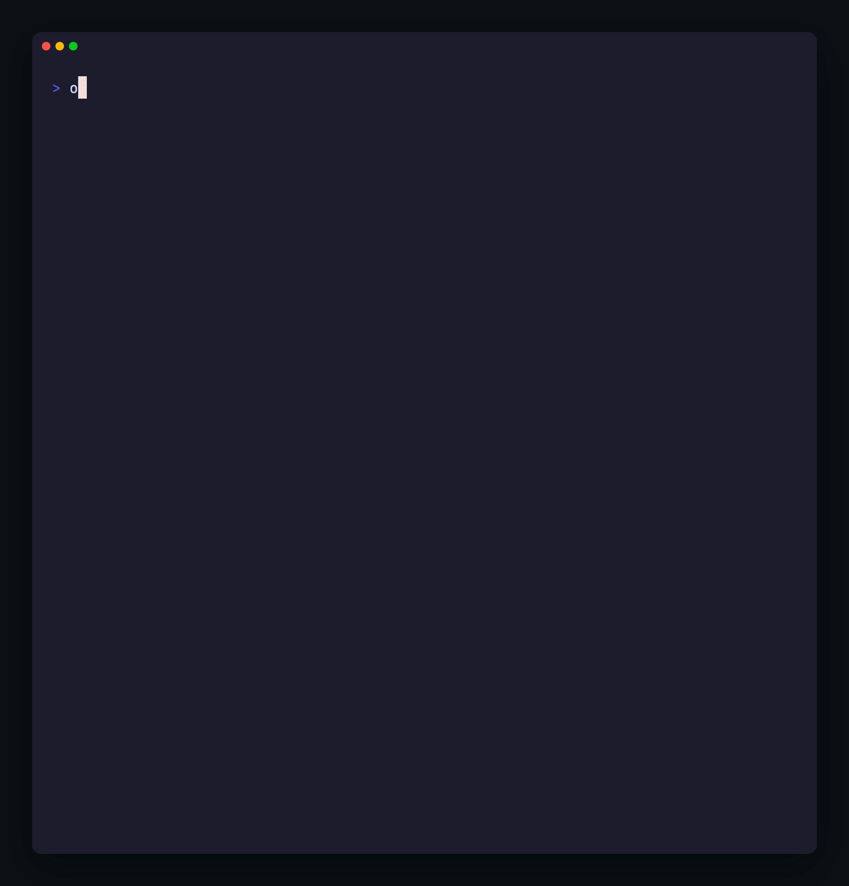
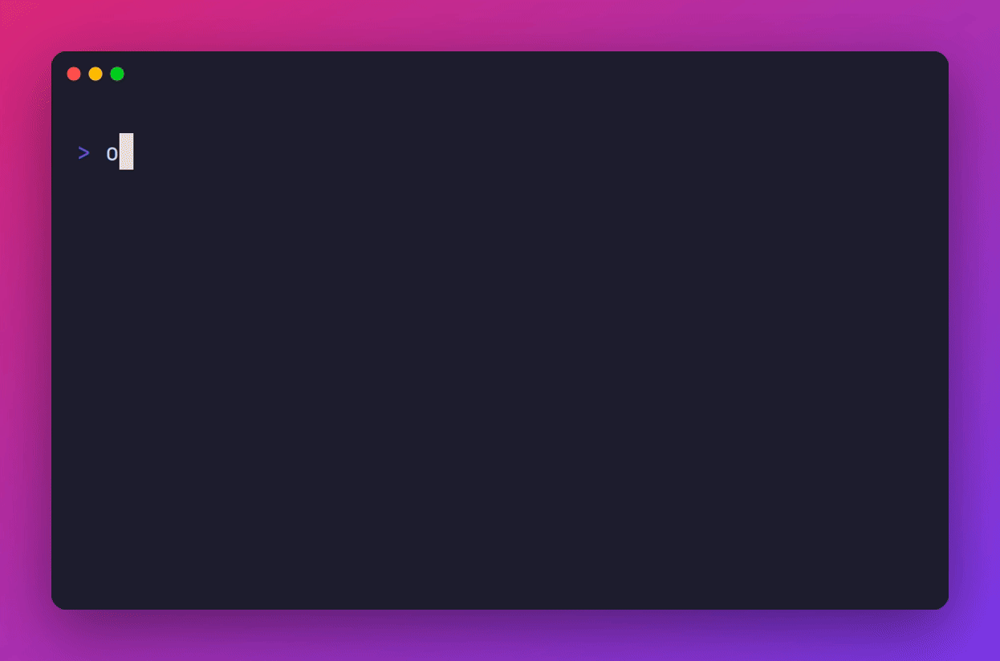
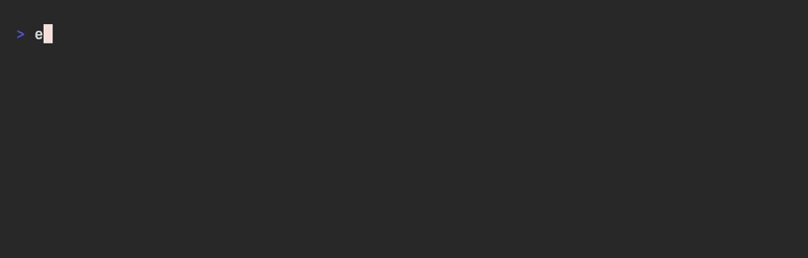
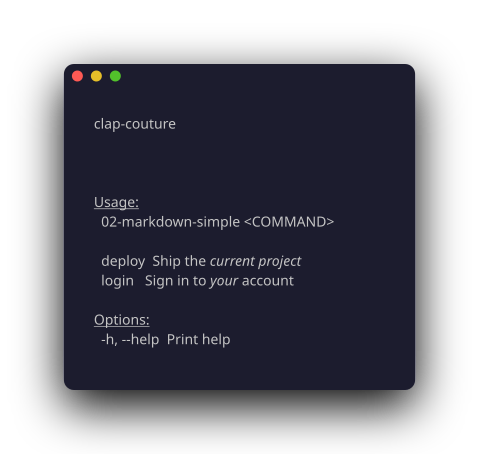

<div align="center">

<picture>
  <source media="(prefers-color-scheme: dark)" srcset="assets/logo-dark.svg">
  
</picture>

<h1>clap-couture</h1>

<p>
  <strong>Haute couture for your command line.</strong><br>
  Categorized <code>--help</code>, interactive prompts, and markdown for your <a href="https://docs.rs/clap"><code>clap</code></a> CLI, with only a few derive attributes.
</p>

<p>
  <a href="https://crates.io/crates/clap-couture"></a>
  <a href="https://docs.rs/clap-couture"></a>
  <a href="https://github.com/markovejnovic/clap-couture/actions/workflows/ci.yml"></a>
  <a href="#installation"></a>
  <a href="https://crates.io/crates/clap"></a>
  <a href="LICENSE"></a>
</p>

</div>

`clap-couture` helps you organize your CLIs to be less intimidating!

<table>
  <tr>
    <td align="center"><b>clap</b></td>
    <td align="center"><b>clap + couture</b></td>
  </tr>
  <tr>
    <td valign="top">
      <picture>
        <source media="(prefers-color-scheme: light)" srcset="assets/01-orbit-disorganized-light.svg">
        
      </picture>
    </td>
    <td valign="top">
      <picture>
        <source media="(prefers-color-scheme: light)" srcset="assets/01-orbit-organized-light.svg">
        
      </picture>
    </td>
  </tr>
</table>

And it allows you to fashionably ask the user for input if they don't provide
it from the CLI.

<div align="center">
<picture>
  <source media="(prefers-color-scheme: light)" srcset="assets/03-interactive-light.gif">
  
</picture>
</div>

# Getting Started

Install it:

```bash
cargo add clap-couture --features full
```

Add the `Couture` derive and swap out `parse` for `couture_parse`.


```diff
-#[derive(Parser)]
+#[derive(Parser, Couture)]
 struct Cli { /* ... */ }

-let cli = Cli::parse();
+let cli = Cli::couture_parse();
```

## Features

`clap-couture` aims to make your `clap` more friendly to your users.

### Categories

`clap` lists every subcommand under one `Commands:` heading. That's fine with
five commands, and a wall of text with thirty. Couture lets you group them:

```rust
#[derive(Subcommand, Couture)]
#[couture(categories = {
    "deploy" = {},
    "account" = {
        title = "Account & sync:",
        description = "Who you are, on every machine"
    },
})]
enum Cmd {
    #[category("deploy")]  Deploy,
    #[category("account")] Login,
    Logs, // no category: listed first, under no heading
    #[category("deploy")]  Rollback,
    Search,
    #[category("deploy")]  Secrets,
    Status,
    #[category("account")] Sync,
}
```

### Prompts

Clap isn't really interactive. clap-couture fills that gap! Mark an arg with
`#[couture(prompt)]`, and when the user leaves it out, couture asks for it
(that's the GIF up top):

```rust
#[derive(Parser, Couture)]
struct Cli {
    /// Application name.
    #[arg(long)]
    #[couture(prompt)] // asks the doc comment
    app: String,

    #[arg(long)]
    #[couture(prompt = "Tail the logs afterwards?")]
    follow: bool,

    #[arg(long, value_enum)]
    #[couture(prompt = "Which region?")]
    region: Region,

    #[arg(long, default_value_t = 2)]
    #[couture(prompt = "How many replicas?")] // pre-filled with 2
    replicas: u16,
}
```

The prompt fits the field's type:

| Field                          | Prompt                                   |
|--------------------------------|------------------------------------------|
| `bool`                         | yes/no                                   |
| a `ValueEnum`                  | picker                                   |
| `Vec` of a `ValueEnum`         | multi-picker                             |
| `Vec<T>`                       | one value at a time, until an empty line |
| `Option<T>`                    | skippable                                |
| `SecretString`, with `secret`  | masked, like `sudo`                      |
| any one value, with `editor`   | your `$EDITOR`, like `git commit`        |
| anything clap can parse        | text, parsed by clap's own parser        |

Answers go through clap's value parser, so a bad answer gets clap's error message and the question
again.

### Confirmations

`#[couture(confirm = "...")]` on a `bool` asks before doing something you can't
take back.

```rust
#[arg(long)]
#[couture(confirm = "Delete {name} for good?")]
force: bool,
```

<picture>
  <source media="(prefers-color-scheme: light)" srcset="assets/05-interactive-confirm-light.gif">
  
</picture>

### Piped input

`#[couture(accept_stdin)]` lets an arg come from a pipe, so `echo hi | post`
works like `post --message hi`.

```rust
#[arg(long)]
#[couture(prompt, accept_stdin)]
message: String,
```

<picture>
  <source media="(prefers-color-scheme: light)" srcset="assets/10-interactive-stdin-light.gif">
  
</picture>

## Markdown

With the `markdown` feature, doc comments and category descriptions render in
the terminal:

```rust
enum Cmd {
    /// Ship the **current** project.
    Deploy,
    /// Sign in to *your* account.
    Login,
}
```

<picture>
  <source media="(prefers-color-scheme: light)" srcset="assets/02-markdown-simple-light.svg">
  
</picture>

# Learn more

- [The docs](https://docs.rs/clap-couture), with a tour of every feature.
- [The examples](crates/clap-couture/examples), each runnable with
  `cargo run -p clap-couture --example <name>`.

# Donationware

**`clap-couture` is donationware.** That means that if you like `clap-couture`,
if you like my work and if you want to support clap-couture or me, you *should*
donate. I like money as much as the next person, but I don't need it. **There
are people who do**. Here are some institutions you can consider:

- 🌍 [United World College](https://uwc.org/support-us/) transformed my life by
  taking me from a backwater swamp and opening my eyes to different cultures,
  worldly cultures of thought and helping me be financially secure. **Help
  provide kids the same opportunity.** My cohort are all amazing people who are
  all transforming the world.
- 🇮🇷 [Children of Persia](https://www.childrenofpersia.org/) is a fund which
  provides sustainable healthcare and education support to children in Iran.
  With the ongoing war, **children need our support more than ever**. Iran is
  is one of the west's most important cultures and the hell children have to
  experience in Iran is a disgrace and an insult to Persia's **critical impact**
  to the Greco-Roman legacy. **Help kids in Iran have the opportunity to
  survive.** (_Note this is one of the few charities which directly supports
  Iran and UN donors can support._)
- 🇵🇸 [Palestine Children's Relief Fund](https://www.pcrf.net/) provides medical
  care to injured and ill children who need access to medical care. **Help kids
  survive war.** The ugly reality is many won't and we have to help as many as
  we can. If you care about _basic survival for kids in war_, this is your best
  donation place.
- 🇺🇳 [UNICEF Early Childhood Development
  Kit](https://www.unicef.org/supply/early-childhood-development-ecd-kit)
  provides toys across the world to reduce the severity of developmental issues
  to kids caught in conflicts. For many of its faults, UNICEF has helped the
  war-torn country I found myself growing up in. **Help toddlers and very young
  children develop.**
- 🇺🇸 [Donors Choose](https://www.donorschoose.org/) is [empirically
  proven](https://news.umich.edu/even-small-crowdsourced-projects-from-teachers-make-a-difference-for-students/)
  to improve kids scores in US schools by about 1%. **If you care about
  supporting kids in the US, this is the one.**
- 🇨🇳 [Standford REAP](https://sccei.fsi.stanford.edu/reap) aims to make an
  educational improvement in rural China. [Roughly 85% of toddlers growing up
in rural China experience development
delay](https://www.sciencedirect.com/science/article/pii/S014759671930023X?via%3Dihub).
  During my high-school, I have met with some of the wonderful, bright and
  curious kids in rural schools from Hubei. **Help rural Chinese kids avoid
  developmental delays and improve education** For any Chinese natives, please
  reach out to me if you know of a better charity that suits China's needs
  better.

Our future is, by definition, in the hands of our children. The only effective
way towards peace and escape from the ecological damnation is if we pour
everything we can into our future. **Email me your receipt for any of the
aforementioned and I will match with a total cap of up to $1K/mo.** Hopefully I
can figure out a better way to handle matching, but email is the best way for
now.

# License

[MIT](LICENSE)
